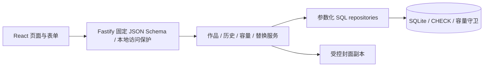

# Limited Library｜L0 设计与实施计划

日期：2026-10-15（Asia/Shanghai）
状态：设计可审阅，等待架构确认；未实施 MVP。

依据：项目内《01-Limited-Library-Codex任务书.md》全文。后续用户补充：“弄个已经看过的，我想要收藏，所有看过的都弄上”。本计划据此增加完整已看／已读历史清单及收藏能力。没有用户片单，不生成或冒认个人记录。

## 1. 目标、边界与现状

目标：收藏柜只保留有限作品；历史清单完整保存所有已看／已读记录，并允许收藏、查询和补录。首版仍是单用户本地 Web App，不引入账号、网络元数据、云同步、游戏或社交。

当前目录 `C:\Software\Limited Library` 即项目根，初始仅有任务书，未建立 Git 仓库、README、依赖、锁文件、源码、数据库、构建或测试配置。检查了 C:\、C:\Software\ 与当前目录的 AGENTS.md，未发现文件；遵循聊天中用户提供的 AGENTS.md。任务书原件不修改，SHA-256 见 VALIDATION。

本阶段产出：README、此计划、可执行 SQL 草案、标准库设计检查与验证记录。**不建立真实用户数据库、不安装应用依赖、不把计划脚本称为可运行应用、不越过设计确认点。** 用户显式调用 github-project，授权此项目设计成果提交并同步公有 GitHub；不发布网站或 Release。

## 2. 产品规则与完整已看清单

### 2.1 六类容量

| 分类 | 键 | 默认容量 | 已完成入口 |
|---|---|---:|---|
| 电视剧 | tv | 10 | 已看电视剧 |
| 电影 | movie | 10 | 已看电影 |
| 动漫 | anime | 10 | 已看动漫 |
| 纪录片 | documentary | 6 | 已看纪录片 |
| 话剧 | theatre | 10 | 已看话剧 |
| 漫画 | comic | 5 | 已读漫画 |

总上限 51 是默认值，各分类独立限额，不跨类借槽。容量为非负整数；0 仅允许该类无保留项，不提供无候选的替换循环。

### 2.2 三种入口共享作品记录

| 入口 | 查询集合 | 数量限制 | 收藏标记 |
|---|---|---|---|
| 收藏柜 | status != archived | 各分类容量 | 可筛选，未标记也可留柜 |
| 已看／已读 | has_completed = 1，包括柜内与归档 | 历史无限额，明确分页 | 支持标记、取消和只看收藏 |
| 归档区 | status = archived，可能看完也可能未看完 | 历史无限额，明确分页 | 保留原标记 |

“收藏柜”表示占位保留，“收藏”按钮表示 favorite 喜欢标记；界面用位置标签“柜内／历史”消除歧义。给历史记录点收藏不会自动移入柜子；“放入收藏柜”是单独操作，满位必须替换。首页容量只统计柜内记录，已看总数单独标注，不能把两者相加当槽位数。

不新建一套重复的 watched_items 表。已看列表是现有 media_items 的视图，因此标题、封面、备注、收藏只维护一份。相同 id 跨入口出现，不产生额外占位；同名但不同版本可分别记录，列表条数代表作品记录数，不代表唯一剧名数。

### 2.3 完成事实与状态分开

沿用任务书 status 的五个值 planned / watching / completed / dropped / archived；增加：

- hasCompleted / has_completed：是否曾看完／读完，默认 false。标记 completed 同事务设 true；归档、重看、弃看都保留此事实。
- archivedFromStatus / archived_from_status：归档前的四种非归档状态，恢复时默认恢复它。直接补录历史用 completed。
- dateCompleted 仍可为空：记得看完但忘记日期也可加入已看清单。删除日期不自动抹掉完成事实。
- completed 或填写 dateCompleted 必须对应 hasCompleted=true；数据库 CHECK 兜底。已看历史筛选使用 has_completed，不依赖可空日期或当前 completed 状态。
- 用户若纠正误标，可在编辑里显式取消“曾看完／读完”，同时确认移出已看清单、清空完成日期；若当前状态／归档前状态是 completed，必须同时改为合法其他状态。这是数据纠错，不是自动流程。
- 首版不记录每次重看明细，也不存观看次数；重看用 watching，仍在已看清单。再次完成可由用户明确更新最近完成日期；不自动改写已有日期。

### 2.4 典型操作

1. **补录已看／已读**：选择分类、标题，完成日期可选；默认 hasCompleted=true、status=archived、archivedFromStatus=completed，favorite 可选。直接写历史，容量为 0 或柜子满也成功。
2. **看完柜内作品**：status 改为 completed、hasCompleted=true；继续占位，同时出现在已看清单。不自动归档。
3. **历史作品标记收藏**：只改 favorite，不占新槽；跨入口即时一致。
4. **归档柜内作品**：保存原状态至 archivedFromStatus，设 archived，保留完成事实、评分、备注、封面和 favorite，释放一个槽位。
5. **历史作品放入收藏柜**：恢复归档前状态，清空 archivedFromStatus；目标类满时走 Replace Mode。可在恢复时选择新的非归档状态。
6. **删除**：永久移除记录，包含已看清单中的对应记录；确认页必须说明。若想保留历史，推荐归档。首版没有回收站。

补录是手动表单，MVP 不默认扫描硬盘、登录第三方、抓取片单或批量导入。本次没有收到具体作品数据，所以“所有看过的”先落实为完整记录能力，不声称已替用户录入。

### 2.5 其余基线

- planned / watching / completed / dropped 均占位；归档不占位。favorite 不决定是否占位。
- 评分为 NULL 或 0–10、0.5 步长；NULL 显示“未评分”，0 是有效分数。
- 标题 trim 后必填；originalTitle 可空并参与搜索。同名允许，添加时给近似重复提示，不建标题唯一约束。
- 日期是本地日历 YYYY-MM-DD；createdAt / updatedAt 是 UTC。未知完成日期保留 NULL，不能编造。
- 已看清单默认按完成日期降序、NULL 最后，再按 createdAt / id 稳定排序；支持添加日期、标题、评分排序。

## 3. 架构与模块责任



选择任务书推荐的 React + TypeScript + Vite、Node + Fastify、SQLite + better-sqlite3、npm workspaces。没有现存技术栈需要迁就。首版不引入全套后台 UI、全局状态框架、ORM 或事件系统；共享 contracts 放枚举、DTO 和固定运行时 JSON Schema。

拟定结构（L1 后创建；当前不生成空壳冒充实现）：

```text
apps/web/src/
  pages/            Cabinet, Category, History, Archive, Settings
  components/       MediaCard, ItemForm, ReplaceDialog, Pagination
  api/              请求、防伪令牌、错误映射
apps/server/src/
  routes/           运行时参数校验与 HTTP 映射
  services/         Item, History, Replacement, Capacity, Asset
  repositories/     参数化 SQL，无业务绕过入口
  db/migrations/    有序、带校验和的正式迁移
  config/           生产 / 开发 / 测试路径与端口
packages/contracts/
tests/              临时库集成、并发、关键 E2E
scripts/            本地开发协调与备份工具
```

依赖版本策略：本机 Node 24.16.0、npm 11.13.0 已查实；Node 24 官方列为 LTS。React、TypeScript、Vite、Fastify、better-sqlite3 的具体版本不在设计阶段猜填。L1 读取包 engines / 官方支持，固定一组兼容版本，Windows 本机安装并实测驱动、事务后写入锁文件和 VALIDATION；失败先排查，不自动装编译工具、不修改全局 PATH、不切技术栈。官方支持不等于该组合已本地通过。

## 4. 数据库契约与 SQL 草案

[SCHEMA.sql](SCHEMA.sql) 是本节的可执行设计快照，不是已经安装到用户数据目录的迁移。五张 STRICT 表，至少要求 SQLite 3.37；具体驱动内置 SQLite 版本在 L1 再确认。每个连接开启 foreign_keys，生产拟 WAL + synchronous=FULL + busy_timeout=2000ms。

### 4.1 categories

| DB 字段 | API 字段 | 类型、默认与约束 |
|---|---|---|
| id | id | TEXT PK，六个固定键，禁止改 id / 删除分类 |
| name | name | TEXT NOT NULL、非空，seed 固定中文名 |
| capacity | capacity | INTEGER NOT NULL、>=0，默认 seed 10/10/10/6/10/5 |
| sort_order | sortOrder | INTEGER NOT NULL UNIQUE，seed 1–6 |
| updated_at | updatedAt | TEXT NOT NULL，UTC Z 字符串 |
| version | version | INTEGER NOT NULL DEFAULT 1、>=1，设置页乐观锁 |

### 4.2 media_items

| DB 字段 | API 字段 | 类型、默认与约束 |
|---|---|---|
| id | id | TEXT PK，服务生成 UUID；运行时严格验证 UUID |
| title | title | TEXT NOT NULL、trim 后非空 |
| original_title | originalTitle | TEXT NULL，非空时 trim |
| category_id | category | TEXT NOT NULL FK categories(id)，RESTRICT |
| cover_asset_id | cover | TEXT NULL FK assets(id)，RESTRICT |
| status | status | TEXT NOT NULL，五值 CHECK，无隐式默认 |
| rating | rating | REAL NULL，0–10 且 rating*2 为整数 |
| date_added | dateAdded | TEXT NOT NULL，真实 YYYY-MM-DD、本地日期 |
| date_completed | dateCompleted | TEXT NULL，同上 |
| notes | notes | TEXT NOT NULL DEFAULT '' |
| favorite | favorite | INTEGER NOT NULL DEFAULT 0，0/1 |
| has_completed | hasCompleted | INTEGER NOT NULL DEFAULT 0，0/1；completed / 完成日期要求 1 |
| archived_from_status | archivedFromStatus | archived 时必须为四种活动状态之一；其他状态必须 NULL |
| created_at | createdAt | TEXT NOT NULL，UTC Z |
| updated_at | updatedAt | TEXT NOT NULL，UTC Z |
| version | version | INTEGER NOT NULL DEFAULT 1、>=1 |

状态、完成事实、归档前状态的组合由 CHECK 保护。日期以 GLOB + SQLite date(..., '+0 days') 标准化比对且显式拒绝 NULL，避免 CHECK 的 NULL 放行；API 再按同一日历规则验证。不禁止完成日期早于补录日；不加“今天以前”等会阻碍纠错的时间约束。UTC 字符串 SQL 只约束格式，API 必须验证真实时间。

### 4.3 assets

| 字段 | 类型与约束 |
|---|---|
| id | TEXT PK，服务生成 UUID |
| filename | TEXT NOT NULL UNIQUE，服务生成 id.ext；禁止 /、反斜线、冒号、.. |
| mime | TEXT NOT NULL，image/png、image/jpeg、image/webp |
| size | INTEGER NOT NULL，1–5242880 |
| created_at | TEXT NOT NULL，UTC Z |

不接收客户端文件路径作为存储名，不存原始私人路径。schema 的 mime CHECK 不能替代真实图片解码。assets 的 FK 保护引用；删除作品只删除作品行，不直接删文件。安全垃圾回收见第 9 节。

### 4.4 schema_migrations

version INTEGER PK > 0；name TEXT NOT NULL；checksum TEXT NOT NULL 为小写 64 位 SHA-256；applied_at TEXT NOT NULL UTC。正式迁移在 L1 按版本顺序、单事务执行，迁移前备份，成功后记录。此草案不伪造已执行迁移行。

### 4.5 mutation_requests

request_id TEXT PK（API 校验 UUID）；operation TEXT NOT NULL（item.create / item.update / item.delete / replacement / category.update）；payload_hash 小写 64 位 SHA-256；result_json TEXT NOT NULL、合法 JSON；created_at TEXT NOT NULL UTC。

所有业务写入带 requestId，用同事务保存成功响应（含 HTTP status、DTO、删除确认）。hash 包含操作、目标 id、expectedVersion 与按字段顺序标准化后的参数，不含防伪令牌；默认值在 hash 前统一，避免等价请求差异。去重查询必须在读当前 version / 是否存在之前完成。相同 UUID + 相同 hash 返回原成功结果；不同 hash 返回 REQUEST_ID_CONFLICT；失败事务不保存成功结果，可纠正后以新 UUID 请求。首版去重记录不定期清理，不许静默失去重试保证；不存 notes 全文到日志。

assets 上传不是业务写事务：先持久化受控未引用副本及 assets 行，上传重试可能产生未引用副本，由后续安全清理处理，不冒称上传端已幂等。

### 4.6 全部索引、视图与守卫

除主键 / UNIQUE 的自动索引外，显式索引：

| 名称 | 列 / 条件 | 目的 |
|---|---|---|
| idx_items_category_status | category_id, status | FK、分类保留数 |
| idx_items_cover | cover_asset_id | FK 引用查询与清理 |
| idx_items_history | category_id, date_completed DESC, created_at DESC, id；WHERE has_completed=1 | 已看分页 |
| idx_items_archive | category_id, updated_at DESC, id；WHERE status='archived' | 归档分页 |

v_category_summary 从 categories LEFT JOIN 作品，每分类返回 retained / capacity / remaining；零作品也返回。v_completed_items 仅筛 has_completed=1，是只读完整历史。收藏用小数据集过滤，暂无证据需要独立索引。搜索首版包含匹配，SQL 参数绑定、转义 % / _ / 反斜线，英文仅声明 ASCII 大小写不敏感；中文按字面，不承诺完整 Unicode 折叠。L2 实测相同行为，暂不用 FTS。

触发器清单：items_capacity_insert、items_capacity_update、categories_capacity_update、categories_id_immutable、categories_no_delete、items_id_immutable。前两个拒绝超容量；UPDATE 计数排除 OLD.id，不把同分类编辑多算一次；categories_capacity_update 拒绝缩容到现有保留数以下；id 不可变防止同一记录身份漂移。守卫只校验并 RAISE(ABORT)，不在 BEFORE 里改写行。ABORT 只撤回当前语句，服务必须显式回滚整个事务。

## 5. API、校验与错误

统一 JSON 请求，固定代码拥有的 schema，additionalProperties=false。拟限制 title / originalTitle <=300 字符、notes <=10000 字符、列表 pageSize 1–50 默认 24、q <=300 字符，避免无限分页与大请求。id / requestId 走 UUID 校验，expectedVersion 正整数。字段超限提示而非截断。

| 接口 | 固定请求 / 响应语义 |
|---|---|
| GET /api/health | 最小健康状态，不泄漏数据目录或个人内容 |
| GET /api/session | 提供当前本地会话 CSRF token，仅可信 Host，禁止缓存 |
| GET /api/summary | 六类 retained / capacity / remaining，另返 completedCount，不混算 |
| GET /api/items | scope=retained(default)/history/archive；q、category、status、favorite、placement、sort、page、pageSize |
| GET /api/items/:id | 单条完整 DTO 或 404 |
| POST /api/items | {requestId, item, placement:'cabinet'/'history'}；history 强制生成已完成归档组合 |
| PATCH /api/items/:id | {requestId, expectedVersion, changes}；普通编辑、归档、恢复、分类变更均校验容量 |
| POST /api/replacements | 原子替换，见第 6 节；支持 create / restore / move |
| DELETE /api/items/:id | {requestId, expectedVersion}，UI 已明确永久后果；返回可去重的删除结果 |
| GET /api/categories | 六类容量、当前保留数、version |
| PATCH /api/categories/:id | {requestId, expectedVersion, capacity} |
| POST /api/assets | multipart 受控封面副本；返回 {assetId, url} |
| GET /api/assets/:id | 只按 assetId 查库后读受控文件；正确 MIME 与 nosniff |

列表响应 `{items,total,page,pageSize}`；分页排序含 id，过滤变化回到第一页。scope=history 永远带 has_completed=1；scope=archive 永远带 archived；默认 retained 排除归档。status 筛选不能覆盖 scope 的基础条件。history 可用 placement=all(default)/cabinet/history 作位置筛选；其他 scope 的 placement 固定，不接受冲突组合。历史的完成事实仍由 has_completed 决定。

错误结构 `{code,message,details?}`，UI 只按 code 分支：

| HTTP | code | 含义 / UI |
|---|---|---|
| 400 | VALIDATION_ERROR | 指明字段、保留输入 |
| 403 | LOCAL_REQUEST_REJECTED | Host / Origin / token 不合法 |
| 404 | ITEM_NOT_FOUND / ASSET_NOT_FOUND | 提示刷新，不当作成功 |
| 409 | CATEGORY_FULL | 分类、capacity、retained；提供替换入口 |
| 409 | CATEGORY_DISABLED | 容量 0，去设置；不显示替换 |
| 409 | VERSION_CONFLICT | 页面的 expectedVersion 已旧，保留草稿，要求重载比较 |
| 409 | CAPACITY_TOO_SMALL | 当前数与最小合法容量 |
| 409 | REQUEST_ID_CONFLICT / INVALID_REPLACEMENT | 请求 id 参数不同 / 候选非法 |
| 413 / 415 | ASSET_TOO_LARGE / ASSET_TYPE_UNSUPPORTED | 封面大小 / 真正解码格式不支持 |
| 503 | DATABASE_BUSY | 有限超时后提示稍后重试，同一请求重用 UUID |
| 500 | STORAGE_FAILURE | 失败不显示成功，不暴露 SQL 或私密备注 |

普通 PATCH 不允许只改 archived 状态而不处理 archivedFromStatus；服务负责生成合法组合。hasCompleted 的显式纠错走同一 PATCH，要求完整且一致的变更。

## 6. Replace Mode、原子性与并发

### 6.1 流程

```text
填写柜内新增 / 恢复 / 跨类转入 → 请求服务
  有空位：直接成功
  容量 0：去设置（不弹替换）
  已满：409 CATEGORY_FULL，表单和上传 assetId 留在前端
      → 选择目标分类内占位的旧作品
      → 归档（默认）或永久删除
      → 最终摘要与确认
      → 一次事务，成功后刷新；失败保留草稿并显示冲突
取消：不发写请求、不改数据、回到原表单
```

补录 history 永远不需要替换；历史点收藏也不需要。恢复 / move 可复用原作品的 id，候选必须不同 id。同分类纯编辑和历史内部改分类不增加容量；跨类柜内作品计入目标类，源类只有事务成功后才释放。

### 6.2 请求草案

```json
{
  "requestId": "UUID",
  "targetCategory": "movie",
  "candidate": {"id": "OLD_UUID", "expectedVersion": 3},
  "disposition": "archive",
  "incoming": {"kind": "restore", "id": "HISTORY_UUID", "expectedVersion": 2, "status": "completed"}
}
```

incoming 为互斥联合：create 携带完整 item；restore 携带已归档记录 id / version / 恢复状态；move 携带柜内记录 id / version / 目标类变更。服务端校验所有字段，不接受任意操作名或 SQL。非满位的过期替换请求返回 INVALID_REPLACEMENT，让用户重新提交普通操作，不能悄悄多归档一条。

### 6.3 事务顺序

```text
固定请求校验；封面若有已在事务外上传
BEGIN IMMEDIATE
  查询 requestId：相同 hash → 返回旧结果；不同 hash → 冲突
  读取目标分类容量（0 单独报错）与当前保留数
  读取 incoming 最新记录及 version（create 先校验新数据）
  读取候选：存在、version 相等、目标分类、非 archived、不是 incoming
  确认本次操作确实增加目标类占位且目标类当前已满
  archive 候选：保存其原 status，保留 has_completed / favorite / 日期，version + 1
    或 DELETE 候选
  INSERT 新作品 / UPDATE 同一已有 incoming（WHERE id=? AND version=?）
  复查所有受影响分类 retained <= capacity
  读取结果 DTO；写 mutation_requests（同事务）
COMMIT
任何错误（包括 COMMIT 失败）：若仍有活动事务，ROLLBACK
```

UPDATE / DELETE 影响行数必须恰好 1；否则整笔冲突回滚。BEGIN 失败无事务可回滚；回滚失败要丢弃连接，不能继续复用并掩盖存储错误。事务内部不 await 上传、不等待用户、不进行外部网络调用。SQLite 只允许一个写事务；有限 busy timeout 后映射 503。

普通 create / patch / delete / category.update 同样使用 BEGIN IMMEDIATE、requestId 去重和事务内复查。作品及容量更新 version + 1、updatedAt 服务生成。两标签页抢最后位置：第一个提交后，第二个在最新数据上得到满位 / version 冲突，或超时为 busy，不产生超额。SQLite 锁负责数据库写入顺序，不以单进程 JS 锁代替。

第一次请求已提交但响应丢失：重试先返回 mutation_requests 旧成功结果，不再校验已被改变的 candidate version、不再归档或删除另一个候选。UUID 不随自动网络重试重新生成；用户改参数后用新 UUID。

## 7. 页面与交互结构

| 路由（计划） | 内容与行为 |
|---|---|
| / | 收藏柜总保留数、六类计数 / 容量 / 余位、各类入口与添加入口；历史总数另标 |
| /cabinet/:category | 卡片与可用槽位、标题搜索、状态与收藏筛选；空槽是添加按钮 |
| /history | 所有已看／已读、六类切换、独立数量、搜索、收藏 / 位置筛选、评分 / 日期排序、分页、补录入口 |
| /history/:category | 六个独立已看／已读清单，可直达、收藏筛选；面包屑回总列表 |
| /items/new | cabinet / history 两种明确模式；先选分类，未知日期留空 |
| /items/:id | 详情与编辑；完成事实、当前状态、柜内／历史、收藏标记分开呈现 |
| /archive | 全部归档（含未看完）、搜索与分页、放入收藏柜；清楚提示是否曾完成 |
| /settings | 六类容量、当前占位数与版本；低于占位数提示先归档 |
| ReplaceDialog | incoming 摘要、同类候选、处置方式、最终确认；永久删除强调历史也将移除 |

主导航：收藏柜 / 已看·已读 / 归档 / 设置。漫画随分类改文案为“已读”；话剧为“已看”。表单中 favorite 的按钮文案为“收藏”，位置动作单独写“放入收藏柜”。列表的收藏筛选包含当前入口内所有记录，history 不因归档丢失收藏。

交互状态：loading、empty、no-results、error、saving、conflict 分开；按钮提交中禁用以防误点但仍须服务端幂等。网络失败不清表单；成功以服务端 DTO 为准。替换候选分页显示可搜索，不把历史作品拿来顶替；候选过期需重新选择并保留 incoming 草稿。

视觉：深色低饱和、封面 2:3、安静占位、CSS 变量、少动画。375px 单列或双列卡片、表单一列；768px 中等列数；1440px 内容最大宽度与留白。容量文字和数值始终可见，不能只靠颜色。标签关联输入、键盘焦点可见、弹窗焦点管理 / Escape 取消 / 关闭后回到触发按钮，错误有可读反馈。完成后保留空日期，不把空评分显示 0。

## 8. 本地运行、路径与访问保护

生产 Node 同源提供静态页面、API、封面；只绑定 127.0.0.1:3210。开发 Vite 127.0.0.1:5173，通过同源代理到本地 API，严格端口；开发服务不开放 LAN。端口占用时失败并说明，不悄悄改端口令防伪白名单失效。

数据路径：生产 `%LOCALAPPDATA%\LimitedLibrary\`；开发 `.local-data\development\`；测试独立临时路径。拟使用 LL_DATA_DIR 显式覆盖，LL_MODE 为 development/test/production；test 缺路径拒绝启动，dev 永不回落生产。路径解析绝对化、检查操作边界，日志只含错误码和记录 id，不输出备注全文或上传原始路径。

Host 只接受选定绑定地址与端口；浏览器写请求 Origin 必须和应用同源，缺失 Origin 的浏览器写入拒绝；固定 Content-Type（JSON，上传例外 multipart），写入要求每次启动生成的高熵会话 token。GET session 本身检查 Host；token 仅放内存，Cache-Control:no-store，不放 URL；浏览器不能通过宽松 CORS 跨源读取。API 的 CSRF 错误不得以“本机所以安全”绕过。CORS 不作为唯一保护；资产响应 nosniff，API 不接受任意路径。

生产库缺失需明确首次初始化入口，不能遇到旧库打不开就换空库；schema 版本过高、损坏、迁移 checksum 不符立即停止。迁移先备份，进程关闭时检查点并关闭连接。核心使用在依赖与浏览器安装完成后不依赖互联网；没有后台抓取服务。

## 9. 封面生命周期与备份设计

上传：限制流总量 5 MiB，在受控临时路径接收；忽略用户原文件名；检查签名并真实解码，只接收 PNG / JPEG / WebP（首版静态图，动画拒绝），拟单边 <=8192 且总像素 <=2000 万。确定依赖后实测解码资源上限、格式和 Windows 兼容性；不以扩展名或 Content-Type 当完成验证。生成 UUID 文件名，写到完整文件后原子改名，再写 assets 行。进程崩溃可留下未引用受控文件，不能让损坏半文件成为作品封面。

业务事务只引用已成功上传的 assetId。失败、取消不删除用户原文件。首版不做后台自动垃圾回收：显式维护命令先列出超过 24 小时且未被引用的 assets 与受控孤儿文件、复查引用并在停服后处理。清理范围只限服务生成目录且不跟随符号链接 / junction；实现前给出可审阅清单，默认不删。封面缺失用占位并保留记录。

L4 提供停服备份：

1. 关闭 Web 服务，确认连接及相关写入全部停止；有锁或未知写入者即停止备份，不批量结束无关进程。
2. 复制**整个**数据目录至新、空、项目外的位置，包含所有 SQLite 辅助文件与封面，保留原库。
3. 在独立副本检查 integrity_check、foreign_key_check、六类数、所有字段及受控封面文件 SHA-256；写清单与版本。
4. 恢复先到另一新目录，通过同样验证，再显式选择该目录启动。不得自动覆盖原生产目录。

WAL 活跃时不只复制 library.sqlite；首版不声称在线热备份。如果未来使用 SQLite Backup API，还必须验证封面文件与备份快照的一致性。源码 GitHub 与个人数据库备份是不同交付，前者不包含私人记录。

## 10. 验收与阶段门槛

| 编号 | 场景 | 预期 | 验证阶段 |
|---|---|---|---|
| A01 | 电影 9/10 新增 | 10/10，余位 0 | L2 SQL + API |
| A02 | 10/10 直接新增 | API / SQL 拒绝第 11 项 | L2 |
| A03 | 满位归档 A 加 B | 仍为 10，A 在归档、若已完成也在已看 | L2 + L3 |
| A04 | 删 A 后插入 B 失败 | 整体回滚，A 在、B 不在 | L2 |
| A05 | 取消替换 | 数据不变、草稿可继续 | L3 E2E |
| A06 | completed / dropped | 柜内仍占位、所有计数一致 | L2 + L3 |
| A07 | 满位恢复 / 跨类转入 | 同样拒绝或原子替换 | L2 |
| A08 | 两独立连接争最后一位 | 最多一成功，冲突 / busy | L2 文件库并发 |
| A09 | 9 项时 10→8 | UI / API / SQL 拒绝 | L2 + L3 |
| A10 | 容量 0 | 禁止柜内新增，补录历史仍成功 | L2 + L3 |
| A11 | 同 UUID 重试 / 不同参数复用 | 旧结果 / REQUEST_ID_CONFLICT，不重复变更 | L2 |
| A12 | 关闭重开 | 数据、容量、封面不丢 | L4 Windows |
| A13 | 独立目录备份恢复 | 字段数量封面一致，原库未覆盖 | L4 |
| A14 | 375px / 键盘 | 无溢出，替换可完成 | L3 + L4 E2E |
| A15 | 六类完整已看 / 已读 | 柜内+归档完整、同 id 只一条 | L2 + L3 |
| A16 | 满柜、零容量补录已看 | 记录成功，不挤占容量 | L2 + L3 |
| A17 | 看完日期未知、重看、归档 | 已看不丢；NULL 日期合法 | L2 + L3 |
| A18 | 收藏历史 / 改分类 / 删除 | 收藏保留且不占新槽；清单随分类；删除明示移除历史 | L2 + L3 |
| A19 | 非法 status / rating / FK / 日期 | 数据库和 API 双重拒绝 | L2 |
| A20 | 非法封面 / 穿越 / 本地恶意 Origin | 拒绝写入，原库不变 | L4 |

| 阶段 | 小而完整的工作 | 完成门槛 |
|---|---|---|
| L0 本次 | 设计、SQL 草案、文档一致性、GitHub 设计交付 | 文件落盘、验证记录、等待确认 |
| L1 | npm workspace、锁文件、前后端骨架、临时库、迁移和 health | Windows 安装驱动、事务读写、启动成功、版本记录 |
| L2 | CRUD、容量、完成历史、幂等替换、设置与参数校验 | 真实驱动 SQL / 独立连接 / API 测试通过 |
| L3 | 收藏柜、完整历史、表单、搜索筛选、归档、替换 | 关键 UI 闭环、取消 / 冲突 / 键盘 / 响应式通过 |
| L4 | 封面、生产同源保护、停服备份恢复、交付说明 | lint、typecheck、build、Windows smoke 和恢复验收 |

验证顺序按任务书：纯规则 → SQLite → API → UI/E2E → lint → typecheck → build → Windows 生产启动。本阶段只验证 SQL 草案与文档，不提前宣称上述应用验收通过。设计检查即使包含 SQLite 并发样例，也不能替代 L2 的 better-sqlite3 集成测试。

预计仍以任务书 8–12 工作日作为粗参考，新增历史界面与字段属于范围增量，实际工期在 L1 完成后重估，不作为保证。

## 11. GitHub、隐私与交付边界

用户显式调用 [github-project 技能](C:/Users/Old%20Beer/.agents/skills/github-project/SKILL.md)，本阶段绑定 OldBeer1/limited-library、main、公有；Inspect 已确认同名仓库不存在。Initialize 已保存配置与首次基线。只提交原始任务书、设计、检查脚本、忽略配置与无凭据绑定，不上传数据目录、封面、环境文件、备份或本机发布状态。

设计完成后先执行检查、审阅差异与 Plan，提交本阶段成果，再由技能脚本扫描提交及可达历史、普通推送、核对远端 SHA。无强推、无 Release、无线上部署。发布结果在最终回复报告；本设计文档的计划句不冒充已同步结果。后续确认后在同项目沿用历史实施，不新建替代仓库。

## 12. 集中确认与下一阶段入口

已经落实的用户补充：六类完整已看／已读清单、所有记录可保存并收藏；没有实际片单数据可导入。

请审阅并确认以下设计基线后开始 MVP：

1. **技术与结构**：React + TypeScript + Vite / Fastify / SQLite，Windows 本地 npm workspaces，数据独立于源码。
2. **容量与历史**：柜内 planned / watching / completed / dropped 都占位；归档不占位。所有已看记录均可进入无限额历史清单，补录默认历史；收藏标记独立于是否入柜。
3. **评分与删除**：0–10、0.5 步长、可未评分；归档保留历史，永久删除连同对应已看记录一起移除。若希望永久保留任何历史，应在实现前改为禁止历史硬删除。
4. **历史粒度**：首版记录“曾完成”及一个可空完成日期，不追踪每次重看；手动补录，批量导入不默认进入 MVP。

这里是任务书明确要求的唯一阶段确认点。确认后从 L1 驱动兼容验证开始，连续推进 L2–L4；不会逐步重复请求许可。

## 13. 技术依据与核验范围

以下官方资料于 2026-10-15 查阅，只支持架构选择与语义说明，不代替本机集成证据：

- [Node 发布与支持周期](https://nodejs.org/en/about/previous-releases)：Node 24 LTS；本阶段保留现有安装，不自动升级。
- [Vite 官方指南](https://vite.dev/guide/)：React/TS 模板、运行时要求与 SPA 构建入口。
- [Fastify 支持政策](https://fastify.dev/docs/latest/Reference/LTS/) 和 [固定参数校验](https://fastify.dev/docs/latest/Reference/Validation-and-Serialization/)：L1 仍须核实具体版本组合；schema 由代码拥有。
- [better-sqlite3 官方仓库](https://github.com/WiseLibs/better-sqlite3)：候选同步事务驱动；Windows 原生兼容性待实测。
- [SQLite 触发器](https://www.sqlite.org/lang_createtrigger.html) 与 [事务](https://www.sqlite.org/lang_transaction.html)：RAISE 与显式事务、单写入者语义。
- [SQLite 日期函数](https://www.sqlite.org/lang_datefunc.html) 与 [备份 API](https://www.sqlite.org/backup.html)：日期标准化边界与未来在线备份参考。
